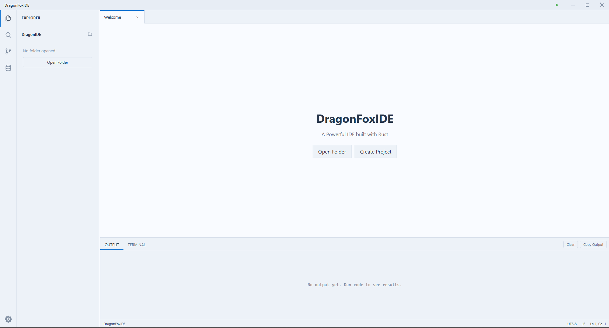

# DragonIDE

[](https://github.com/cyberworrier8088/DragonIDE/actions/workflows/ci.yml)

DragonIDE is a code editor I'm building with Rust and Tauri 2. The front end is plain HTML, CSS and JavaScript, with no npm packages.

It's a work in progress. It runs and the basics work, but it's not ready to replace your main editor, and there are no installers yet.



## What works now

- Editor with syntax highlighting, line numbers, undo/redo per tab, auto indent and bracket matching
- Tab / Shift+Tab indent and unindent the selected lines
- Find and replace (case sensitive, whole word, regex), go to line, zoom
- File explorer: new file/folder, rename, delete, copy path
- Quick Open (`Ctrl+P`) and search across all files (`Ctrl+Shift+F`)
- Run single Rust, JavaScript or Python files, with a Stop button
- Terminal with live output, `cd`, command history and `Ctrl+C`
- Source Control Panel (`Ctrl+Shift+G`): see changed files, stage/unstage, commit (`Ctrl+Enter`), push, pull and start a new repo
- Music panel: pick a vibeyyy (lofi, jazz, synthwave...) and play free internet radio while you code :0
- AI autocomplete: grey ghost-text suggestions while you type, Tab to accept. Works with DragonIDE AI, OpenAI (ChatGPT), Google Gemini (AI Studio), Anthropic (Claude), OpenRouter, Groq, DeepSeek, Mistral, or any OpenAI-compatible server (Ollama, LM Studio). Pick one in Settings
- Explorer right-click menu like VS Code: new file/folder, cut, copy, paste, rename, delete, copy path
- Remote access: code from your phone on the same WIFI. Scan a QR code, then edit, save, run code and use the terminal, while everything runs on the laptop
- Image preview (png, jpg, gif, webp, bmp, ico)
- Drag tabs, resize or hide the explorer and bottom panel
- 8 themes. On Windows, the Glass theme uses the real acrylic blur.
- English and Spanish

## Known problems

- The terminal can't take keyboard input, so interactive programs (a Python prompt, `npm init`) don't work. No colors in output yet.
- Run Code compiles one `.rs` file with `rustc`. It doesn't run Cargo projects.
- I mostly test on Windows. CI builds on Linux and macOS, but I don't use those every day.
- The Git panel can't show diffs or switch branches yet
- Remote access only works on the same WiFi. Don't share the QR code: anyone who has it can edit your files (and run commands, if you allowed it).
- If the same file is open on the laptop and the phone, the last save wins.

If you find a bug, please [open an issue](https://github.com/cyberworrier8088/DragonIDE/issues).

## Run it

You need [Rust](https://rustup.rs) and the Tauri CLI:

```
cargo install tauri-cli --version "^2" --locked
```

Tauri also needs some system libraries:

- **Windows:** [Microsoft C++ Build Tools](https://visualstudio.microsoft.com/visual-cpp-build-tools/) ("Desktop development with C++")
- **macOS:** `xcode-select --install`
- **Linux (Debian/Ubuntu):** `sudo apt install libwebkit2gtk-4.1-dev libxdo-dev libssl-dev libayatana-appindicator3-dev librsvg2-dev`

Then:

```
git clone https://github.com/cyberworrier8088/DragonIDE.git
cd DragonIDE/DragonFoxxDE
cargo tauri dev
```

The first build takes a few minutes. Run Code uses `rustc`, `node` and `python` from your computer, so install the ones you need.

## Keyboard shortcuts

| Keys | Action |
|---|---|
| `Ctrl+S` | Save |
| `Ctrl+P` | Quick Open |
| `Ctrl+Shift+F` | Search in files |
| `Ctrl+F` / `Ctrl+H` | Find / replace |
| `Ctrl+G` | Go to line |
| `Tab` / `Shift+Tab` | Indent / unindent selected lines |
| `Ctrl+Shift+\` | Jump to matching bracket |
| `Ctrl+Alt+R` | Run code (again to stop) |
| `Ctrl+B` / `Ctrl+J` | Hide or show explorer / bottom panel |
| `Ctrl+=` / `Ctrl+-` / `Ctrl+0` | Zoom in / out / reset |
| `Ctrl+Shift+G` | Open Source Control |
| `Ctrl+Enter` | Commit (in Source Control) |

## Repo layout

- `DragonFoxxDE/` is the editor. Rust code is in `src/`, the UI is in `web/`.
- `FoxAi/` is a small code-completion model I'm training from scratch in Rust with [Burn](https://burn.dev). It's not good enough to use in the editor yet. See [FoxAi/README.md](FoxAi/README.md).
- `journels/` is my day-by-day dev journal, with screenshots of each step.

## License

[MIT](LICENSE)