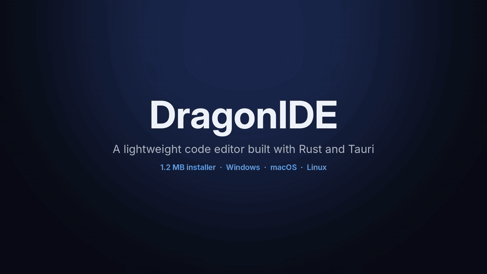

# DragonIDE

A small desktop code editor built with Rust and Tauri.

[](https://github.com/cyberworrier8088/DragonIDE/releases/latest)
[](https://github.com/cyberworrier8088/DragonIDE/actions/workflows/ci.yml)
[](LICENSE)
[](https://hackatime.hackclub.com)

## Description

DragonIDE is a code editor built on [Tauri 2](https://tauri.app). Files, search, git, running code and the terminal are handled in Rust. The interface is plain HTML, CSS and JavaScript (no framework, no bundler, no `node_modules`) and runs in the web view your operating system already has. Since it doesn't bundle a browser, the Windows installer is 1.2 MB. An Electron editor is usually around 100 MB.

What it does:

* Editor with syntax highlighting, line numbers, bracket matching, auto indent and auto-closing brackets and quotes
* Tabs with their own undo history, which you can drag to reorder
* Find and replace (match case, whole word, regex), Quick Open and project-wide search
* Run Rust, JavaScript and Python files, with output shown in an integrated terminal
* Source Control panel: review changes, stage, unstage, commit, push, pull and init a repository
* Auto-save with an adjustable interval
* AI autocomplete as inline suggestions, using your own API key or a local model
* Eight themes (Glass uses native acrylic blur on Windows) and English and Spanish interface
* Phone mode: use the editor from a phone browser while everything runs on your laptop

Safety features:

* Every way of closing the app (close button, `Alt+F4`, taskbar, reload) warns about unsaved files
* If another program changes an open file, for example `git pull`, DragonIDE asks before overwriting it
* CRLF line endings are preserved, so saving doesn't create extra diffs
* Files over 50 MB are refused, very large files open without highlighting, and program output is capped at 1 MB

### Screenshots

[](docs/demo.mp4)

Opening a project, Quick Open, running a Python file, the terminal, Source Control and themes. Click the image for the full-quality video.

## Getting Started

### Dependencies

To run a release build:

* Windows 10 or 11, macOS (Apple Silicon), or Linux

To run code from inside the editor you also need the tools for your language installed: `rustc`, `node` or `python`.

To build from source:

* [Rust](https://rustup.rs) (stable)
* Tauri CLI: `cargo install tauri-cli --version "^2" --locked`
* The [system dependencies for Tauri](https://tauri.app/start/prerequisites/):

| OS | What to install |
|:--|:--|
| Windows | [Microsoft C++ Build Tools](https://visualstudio.microsoft.com/visual-cpp-build-tools/), with "Desktop development with C++" |
| macOS | `xcode-select --install` |
| Debian / Ubuntu | `sudo apt install libwebkit2gtk-4.1-dev libxdo-dev libssl-dev libayatana-appindicator3-dev librsvg2-dev` |

### Installing

Download an installer from the [latest release](https://github.com/cyberworrier8088/DragonIDE/releases/latest):

| Platform | Package | Size |
|:--|:--|--:|
| Windows 10 / 11 | `.exe` or `.msi` | 1.2 MB |
| macOS (Apple Silicon) | `.dmg` | 2.0 MB |
| Linux | `.deb` or `.rpm` | 1.6 MB |
| Linux (any distribution) | `.AppImage` | 80 MB |

The builds are not code-signed yet. On Windows, if you see "Windows protected your PC", click **More info**, then **Run anyway**.

To build from source instead:

```sh
git clone https://github.com/cyberworrier8088/DragonIDE.git
cd DragonIDE/app
cargo tauri build
```

The installers end up in `target/release/bundle/`.

### Executing program

Start DragonIDE and open a folder. To run from source with live reload:

```sh
cd DragonIDE/app
cargo tauri dev
```

Common shortcuts:

| Shortcut | Action |
|:--|:--|
| `Ctrl+S` | Save |
| `Ctrl+P` | Quick Open |
| `Ctrl+Shift+F` | Search in files |
| `Ctrl+F` / `Ctrl+H` | Find / Replace |
| `Ctrl+G` | Go to line |
| `Tab` / `Shift+Tab` | Indent / unindent selection |
| `Ctrl+Shift+\` | Jump to matching bracket |
| `Ctrl+Alt+R` | Run current file (press again to stop) |
| `Ctrl+B` / `Ctrl+J` | Toggle explorer / bottom panel |
| `Ctrl+=` / `Ctrl+-` / `Ctrl+0` | Zoom in / out / reset |
| `Ctrl+Shift+G` | Source Control |
| `Ctrl+Enter` | Commit (in Source Control) |

#### Phone mode

DragonIDE can serve its interface over your local network. Files, git and running code stay on the laptop. The phone only shows the interface.

1. Open a folder in DragonIDE.
2. Open **Settings** (the gear in the bottom left), find **Remote Access (phone)** and click **Start**.
3. Scan the QR code with a phone on the same Wi-Fi network.

#### AI autocomplete

Suggestions appear as ghost text and you accept them with `Tab`. Supported providers: OpenAI, Google Gemini, Anthropic, OpenRouter, Groq, DeepSeek and Mistral. You can also use a local model through Ollama or LM Studio. API keys are stored on your machine and sent only to the provider you pick.

## Help

If Windows blocks the installer, see the note under Installing.

If phone mode doesn't connect, check that the phone and the laptop are on the same Wi-Fi network and that your firewall allows DragonIDE.

If a build fails on Linux or Windows, check that the system dependencies above are installed.

Found a bug or have an idea? [Open an issue](https://github.com/cyberworrier8088/DragonIDE/issues).

## Contributing

The repo layout:

```
DragonIDE/
├── app/         the Tauri app
│   ├── src/              Rust backend: commands, documents, files, search, git, terminal, remote server
│   ├── web/              frontend: HTML, CSS and JavaScript, no build step
│   ├── capabilities/     Tauri permission set
│   └── tests/            frontend tests (node --test)
├── FoxAi/       experimental code-completion model, trained from scratch in Rust with Burn
└── journal/     development journal
```

The frontend calls Rust through Tauri commands. Phone mode runs a small [`tiny_http`](https://crates.io/crates/tiny_http) server in the same process, so phone requests go through the same commands and path checks as the desktop window.

Run the CI checks before opening a pull request:

```sh
cd app
cargo fmt --check
cargo clippy --all-targets -- -D warnings
cargo test
node --test tests/web.test.js
```

Commit messages follow [Conventional Commits](https://www.conventionalcommits.org) (`feat:`, `fix:`, `docs:`, `ci:`). Release notes are generated from `feat:` and `fix:` commits.

Releases follow [Semantic Versioning](https://semver.org). Pushing a `v*` tag runs the release pipeline: it checks that the tag matches the app version, runs the tests on all three platforms, builds the installers and publishes a GitHub release.

## License

This project is licensed under the MIT License - see the [LICENSE](LICENSE) file for details.
