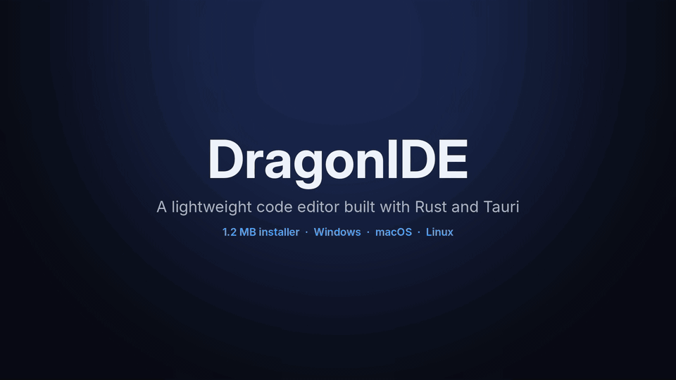

<div align="center">


# DragonIDE

**A lightweight code editor built with Rust and Tauri.**

1.2 MB installer · No Electron · No npm · Code from your phone

<br>

[](https://github.com/cyberworrier8088/DragonIDE/releases/latest)
[](https://github.com/cyberworrier8088/DragonIDE/actions/workflows/ci.yml)
[](https://github.com/cyberworrier8088/DragonIDE/releases)
[](https://tauri.app)
[](https://www.rust-lang.org)
[](LICENSE)

**[Download](#download)** · **[Features](#features)** · **[Phone mode](#code-from-your-phone)** · **[Build](#build-from-source)** · **[Roadmap](#roadmap)**

<br>

<a href="docs/demo.mp4"></a>

<sub>Opening a project, Quick Open, running a Python file, the terminal, Source Control and themes. Click for the full-quality video.</sub>

</div>

<br>

## About

DragonIDE is a desktop code editor built as a [Tauri 2](https://tauri.app) app. The heavy work (files, search, git, running code and the terminal) happens in Rust, and the interface runs in the web view your operating system already has. Because it doesn't bundle a browser, the Windows installer is **1.2 MB**, where an Electron editor ships around 100 MB.

The interface is plain HTML, CSS and JavaScript. It has no framework, no bundler and no `node_modules`.

<table>
<tr>
<td width="33%" valign="top">

**Small by design**<br>
A 1.2 MB installer that uses the system web view instead of bundling a browser.

</td>
<td width="33%" valign="top">

**Everything in one window**<br>
Editor, terminal, Git, project search and Run, with no setup.

</td>
<td width="33%" valign="top">

**Your work is protected**<br>
Unsaved-change warnings, auto-save, and protection when another program changes an open file.

</td>
</tr>
<tr>
<td valign="top">

**Code from your phone**<br>
Scan a QR code and edit the project on your laptop from any phone browser.

</td>
<td valign="top">

**AI autocomplete**<br>
Inline suggestions from the provider you choose, or a local model.

</td>
<td valign="top">

**Cross-platform**<br>
Native installers for Windows, macOS and Linux on every release.

</td>
</tr>
</table>

## Download

| Platform | Package | Size |
|:--|:--|--:|
| **Windows** 10 / 11 | [`.exe` installer](https://github.com/cyberworrier8088/DragonIDE/releases/latest) or `.msi` | 1.2 MB |
| **macOS** (Apple Silicon) | [`.dmg`](https://github.com/cyberworrier8088/DragonIDE/releases/latest) | 2.0 MB |
| **Linux** | [`.deb`](https://github.com/cyberworrier8088/DragonIDE/releases/latest) or `.rpm` | 1.6 MB |
| **Linux** (any distribution) | [`.AppImage`](https://github.com/cyberworrier8088/DragonIDE/releases/latest) | 80 MB |

> [!NOTE]
> Builds are not code-signed yet. If Windows shows "Windows protected your PC", click **More info**, then **Run anyway**.

## Features

### Editing
- Syntax highlighting for common languages, line numbers and bracket matching
- Auto indent, auto-closing brackets and quotes, and multi-line indent with `Tab` / `Shift+Tab`
- Undo and redo history for each tab, and tabs you can drag to reorder
- Find and replace with match case, whole word and regular expressions
- Quick Open (`Ctrl+P`) and search across the whole project (`Ctrl+Shift+F`)
- Eight themes, including Glass, which uses native acrylic blur on Windows
- English and Spanish interface

### Run, terminal and Git
- Run Rust, JavaScript and Python files with `Ctrl+Alt+R`, and stop them at any time
- Integrated terminal with live output, `cd`, command history and `Ctrl+C`
- Source Control panel: review changes, stage, unstage, commit, push, pull and initialize a repository

### Reliability
- Auto-save, with an adjustable interval
- Every way of closing (the close button, `Alt+F4`, the taskbar or a reload) warns about unsaved files
- If another program changes an open file, for example `git pull`, DragonIDE asks before overwriting it
- CRLF line endings are preserved, so saving doesn't create noisy diffs
- Large files and runaway programs can't freeze the editor: very large files open without highlighting, files over 50 MB are refused, and program output is capped at 1 MB

### AI autocomplete
Inline ghost-text suggestions, accepted with `Tab`. Bring your own key for OpenAI, Google Gemini, Anthropic, OpenRouter, Groq, DeepSeek or Mistral, or run a local model with Ollama or LM Studio. Keys are stored on your machine and are sent only to the provider you select.

## Code from your phone

DragonIDE can serve its interface over your local network. Open the project on your laptop, scan a QR code with your phone, and you get the full editor in the phone's browser. Files, Git and running code all stay on the laptop. The phone only shows the interface.

1. Open a folder in DragonIDE.
2. Open **Settings** (the gear in the bottom left), find **Remote Access (phone)** and click **Start**.
3. Scan the QR code with a phone on the same Wi-Fi network.


## Keyboard shortcuts

<details>
<summary><b>Show all shortcuts</b></summary>
<br>

| Shortcut | Action |
|:--|:--|
| `Ctrl+S` | Save |
| `Ctrl+P` | Quick Open |
| `Ctrl+Shift+F` | Search in files |
| `Ctrl+F` / `Ctrl+H` | Find / Replace |
| `Ctrl+G` | Go to line |
| `Tab` / `Shift+Tab` | Indent / unindent selection |
| `Ctrl+Shift+\` | Jump to matching bracket |
| `Ctrl+Alt+R` | Run current file (again to stop) |
| `Ctrl+B` / `Ctrl+J` | Toggle explorer / bottom panel |
| `Ctrl+=` / `Ctrl+-` / `Ctrl+0` | Zoom in / out / reset |
| `Ctrl+Shift+G` | Source Control |
| `Ctrl+Enter` | Commit (in Source Control) |

</details>

## Build from source

**Prerequisites:** [Rust](https://rustup.rs) (stable), the Tauri CLI, and the [system dependencies for Tauri](https://tauri.app/start/prerequisites/).

```sh
cargo install tauri-cli --version "^2" --locked
```

<details>
<summary><b>System dependencies by platform</b></summary>
<br>

| OS | Command or download |
|:--|:--|
| Windows | [Microsoft C++ Build Tools](https://visualstudio.microsoft.com/visual-cpp-build-tools/), with "Desktop development with C++" |
| macOS | `xcode-select --install` |
| Debian / Ubuntu | `sudo apt install libwebkit2gtk-4.1-dev libxdo-dev libssl-dev libayatana-appindicator3-dev librsvg2-dev` |

</details>

```sh
git clone https://github.com/cyberworrier8088/DragonIDE.git
cd DragonIDE/DragonFoxxDE

cargo tauri dev      # run with live reload
cargo tauri build    # build installers into target/release/bundle/
```

Run uses the `rustc`, `node` and `python` already installed on your system.

## Architecture

```
DragonIDE/
├── DragonFoxxDE/         the Tauri app
│   ├── src/              Rust backend: commands, documents, files, search, git, terminal, remote server
│   ├── web/              frontend: HTML, CSS and JavaScript, with no build step
│   ├── capabilities/     Tauri permission set
│   └── tests/            frontend tests (node --test)
├── FoxAi/                an experimental code-completion model, trained from scratch in Rust with Burn
└── journels/             development journal
```

The frontend calls Rust through Tauri commands (`invoke`). Phone mode runs a small HTTP server ([`tiny_http`](https://crates.io/crates/tiny_http)) in the same process, so phone requests go through the same commands and the same path checks as the desktop window.

Found a bug or have an idea? [Open an issue](https://github.com/cyberworrier8088/DragonIDE/issues).

## Contributing

Contributions are welcome. Please run the same checks as CI before you open a pull request:

```sh
cd DragonFoxxDE
cargo fmt --check
cargo clippy --all-targets -- -D warnings
cargo test
node --test tests/web.test.js
```

Commit messages follow [Conventional Commits](https://www.conventionalcommits.org) (`feat:`, `fix:`, `docs:`, `ci:`). Release notes are generated from `feat:` and `fix:` commits.

## Releases

DragonIDE follows [Semantic Versioning](https://semver.org). Pushing a `v*` tag runs the release pipeline. It checks that the tag matches the app version, runs the full test suite on all three platforms, builds the installers, and publishes a GitHub release with generated notes.

## License

Released under the [MIT License](LICENSE).
