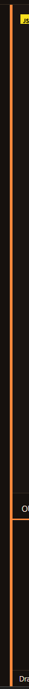
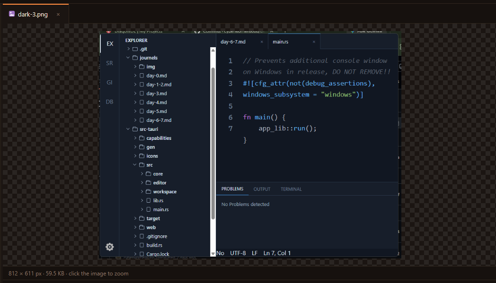
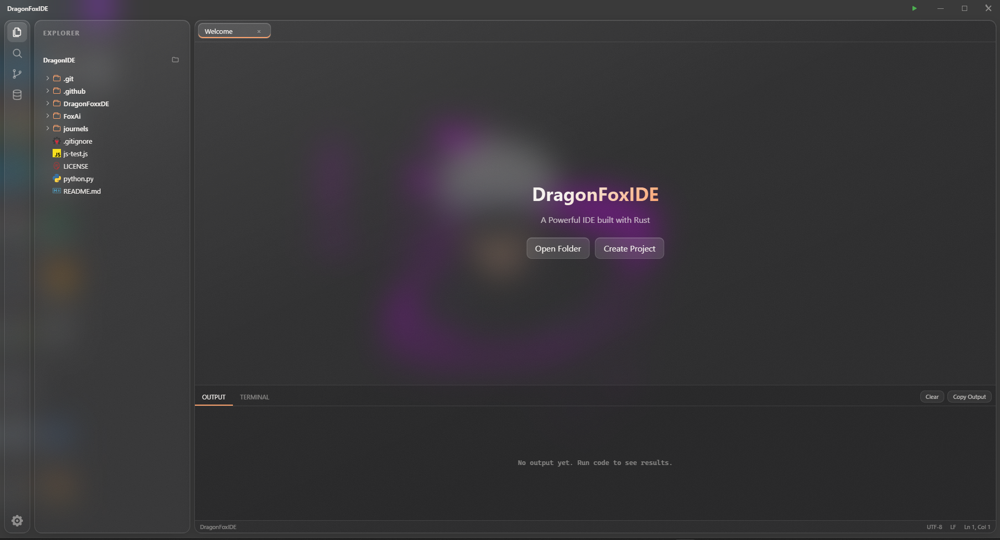

# DAY-26
Today was a really big day. i added a lot of features and also got my first pull request from anthor person!! Some bugs were made by me again while adding featuresss. hahahah!

## First Feature (Explorer remembers and refreashes):

- before this, when i made a file from the terminal, the explorer did't show it. i had to open the folder again
- now the explorer refreshes after every terminal command, and the folders i opened stay open.
- when i close the IDE and open it again, it opens my last folder.
- if that folder was deleted, the IDE forgets it and shows the welcome screen. Before it was just showing an empty explorer :(

## Second Featuress (Drag tabs and resize panels):

- now i can drag tabs to change thir order/
- i can drag the border of the explorer and the bottom panel to make them bigger or smaller.
- Ctrl + B hides the explorer and Ctrl + J hides the bottom panel. Like VS Code :))))
- HTML drag and drop was not working in Tauri on windows. so i made the tab drag with mouse events. that took some times to undestand.

#### images:

drag tabs image:

Resize panels image:

## Third Feature (Image preview and zoom):

- now when i click a png, jpg, gif, webp, bmp or ico file, it shows the image. Before it was showing strange letters because it opened the image as text. hahaha
- images bigger than 50MB don't open, so the IDE doesn't freeze.
- `Ctrl + =` and `Ctrl + -` change the editor font size, `Ctrl + 0` resets it. `Ctrl + mouse wheel` works too.

### images:

Image preview image:

## Fourth Feature (New themes and UI polish):

- added 3 new themes: Frost, Ember and Midnight.
- Glass theme is now real see-through glass with the Windows blur effect. it looks soo cool.
- the activity bar had letters like "SR" as placeholders. now it has real icons.
- the Create Project button was doing nothing. now it opens the folder picker.
- tabs, scrollbars and dialogs look cleaner now.

### images:

Glass theme image:

## README and CI

- i wrote a README so other developers can understand the project and how to run it.
- my senior dev said the first README was too long, so i rewrote it shorter and clearer.
- i added GitHub Actions CI. now every push builds and tests DragonIDE on Windows, macOS and Linux. Green tick means everything is ok ✅
- i learned what CI is, and why it helps when other people send code.

## My first pull request from someone else!!

A person sent me a pull request. It fixed a security problem in the language loading code. Someone could pass a strange language name like `../../something` and load files from outside the locales folder. i checked the change, understood it, and merged it. i was so happy that someone used their time for my project :)

## Some cool fixes:

#### `cd ~` was not going home

it was checking for the wrong text, so `cd ~` gave an error. Now it goes to the home folder.

#### Tab and Shift+Tab

A person told me that when he selects many lines and presses Tab, the lines get deleted. Now Tab indents all selected lines and Shift+Tab unindents them. I typed `setRange` instead of `setRangeText` first and the IDE crashed. hahahah

#### titlebar file name

the file name in the titlebar was put in as HTML. a file with a strange name could break the titlebar. Now it is plain text.

## Why i spent 4h

Because there were many features in one day, and every feature had its own small bugs. the tab drag on Windows and the explorer refresh were the hardest. I had to make sure the open folders don't close after a refresh. Also, the README and CI were new for me, so I had to learn first and then write.

But now DragonIDE feels much more like a real IDE 🦊

Please consider my Valuble 4h :)

This Journel writing after day 27