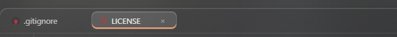

# DAY-27
Today i added file icons, cleaned my Rust code and fixed the terminal probms my clients told me about. And yes, i made typos again. Hahaha!

## First Feature (File icons):

- now every file in the explorer and in the tabs has an icon for its type. Rust, Python, JavaScript, TypeScript, HTML, CSS, JSON, Markdown, images, config files and more.
- special files like `Cargo.toml`, `Cargo.lock` and `.gitignore` get their own icon too.
- unknown files don't get an empty space, they just show the name.
- most icons are SVG files i made by my self.

### images:

Explorer icons image:

Tab icons image:

#### icon bugs i fixed:

- i forgot to add `image.svg`, so images had no icon :(
- i checked the wrong list for special file names, so `Cargo.toml` didn't get the Rust icon. silly mistake
- the Rust and Markdown icons were black, so you couldn't see them in dark themes. now they have colours.

## Second thing (Clean Rust code):

- i ran `cargo fmt`. It formats all the Rust code in the standerd way. My `lib.rs` was using 2 spaces and other files used 4. Now evarthing is the same.
- i ran `cargo clippy`. It found 8 warnings in my code: unused code, a `mut` that is only needed on Windows, and some small thinks.
- i removed old code that was never used. less code = less bugs :)
- i also learned that a lint name must be exact. I typed `dead_close` instead of `dead_code` and clippy shouted at me. hahaha

## Third thing (Terminal fixes):

My clients said the terminal had some problems, so i fixed them all:

- **letters were cut off.** `error` was showing as `erro`. I typed `['r', '\n']` instead of `['\r', '\n']`. One missing `\` and every "r" at the end of a line was gone. hahahah
- **quotes didn't work on Windows.** `git commit -m "fix bug"` was failing becuase Rust was adding extra `\"` before cmd got the command. Now cmd gets the command exactly as i type it.
- **`cls` and `clear` didn't work.** now they clear the terminal, and `Ctrl + L` does too.
- **the warning messages were not yellow.** I typed `waring` instead of `warning` in the class name. typo againnn!!
- **now i can click anywhere in the output to type.** Selecting text to copy still works. (first i wrote `input()` instead of `input.focus()`... fixed it after hahaha)

### images:

Terminal with quotes image:

Terminal clear image:

## Things i learned today

- **Exit code**: every command sends back a number when it finishes. 0 = ok, anything else = something went wrong. That's why my terminal shows the red "Exit code 1".
- `ls` doesn't work in Windows cmd, it is `dir`. Not a bug in my IDE. i was confused first hahaha
- type commands one by one, or join them with `&&`. I put 3 git commands on one line and git got confuesd.

## Why i spent [X]h

Becuase the terminal bugs were really hard to find. The "r" bug and the quotes bug only show up with some commands, so i had to test so many commands to see them. The quote problem on Windows was totaly new for me. Also clippy and cargo fmt were new, so i had to reserch and understand every warning before fixing it.

Next i will add tests and make my CI bigger, so these typos can't reach main again 🦊

Please consider my Valuble [X]h :)
