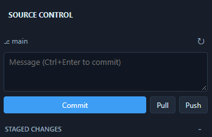
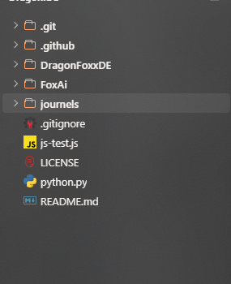

# DAY-28
Today i was added a amzing feature. that was Version Controller that amzing but so time consuming. 

Source version conrtoller image:

if you change something come this image:

Why this toook 2h:
Becuase this was hard t debug git have to implemnt using rust is vary hard and sp time consuming to debug and i want learn so many things and reserch